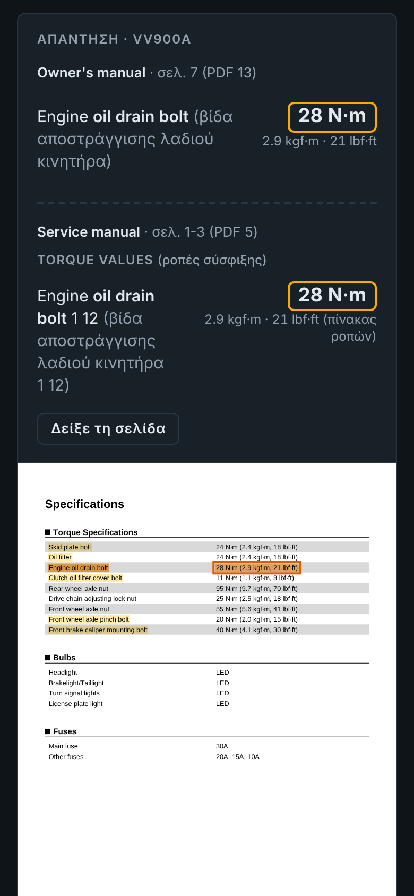
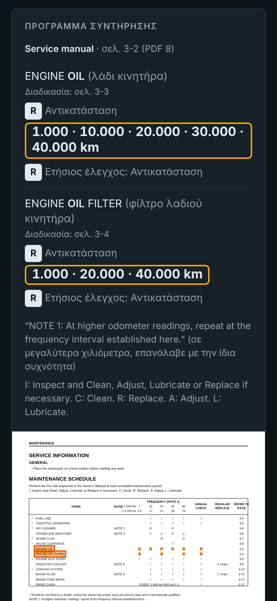
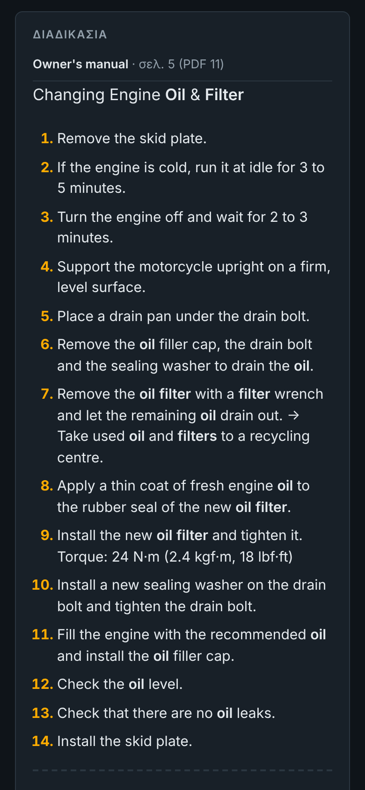
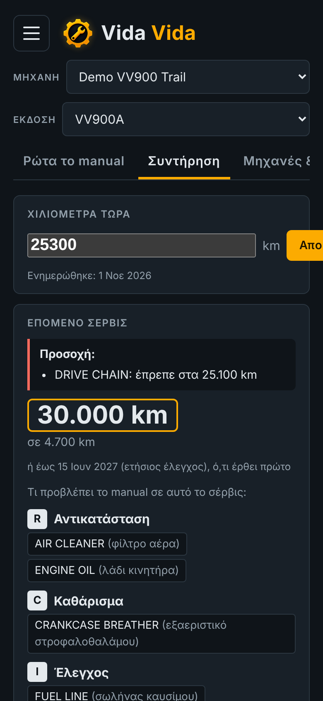
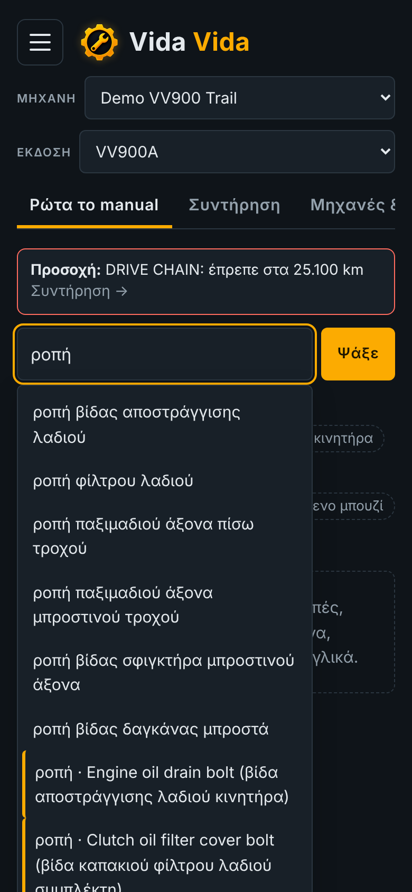
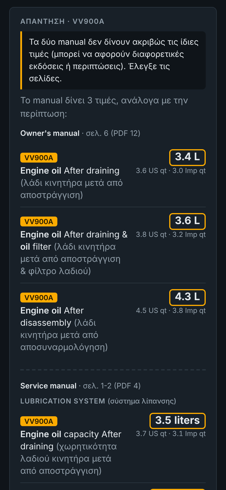
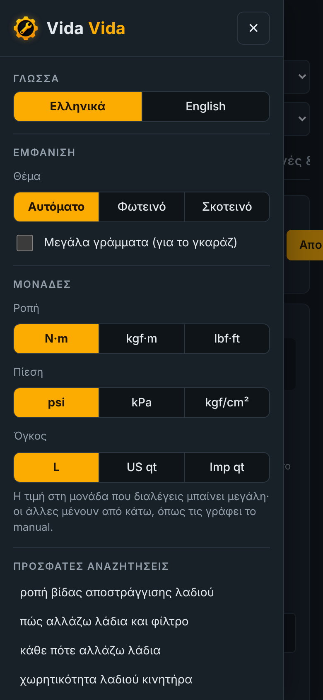

  

<h1 align="center">Vida Vida</h1>

  <b>Ρώτα το manual της μηχανής σου.</b> Ροπές, χωρητικότητες, πιέσεις, «κάθε πότε» και «πώς κάνω» — 
  με τη σελίδα του manual ως απόδειξη. Βιβλίο σέρβις και υπενθυμίσεις. Δουλεύει offline, χωρίς AI.  
  <i>Ask your motorcycle's manual — torques, capacities, schedules and procedures, with the manual page as proof. Works offline.</i>

  <a href="#ελληνικά">Ελληνικά</a> · <a href="#english">English</a>

  
  
  
  

---

## Ελληνικά

### Τι κάνει
- **Ρωτάς κάτι και παίρνεις την τιμή από το manual** — π.χ. «ροπή βίδας αποστράγγισης λαδιού» → **28 N·m**, μαζί με την εικόνα της σελίδας και την τιμή σε πορτοκαλί πλαίσιο.
- **Πρώτα το owner's manual, μετά το service manual** για διασταύρωση· σε προειδοποιεί όταν τα δύο δίνουν διαφορετικές τιμές.
- **Εκδόσεις μηχανής**: βρίσκει μόνο του τις εκδόσεις μέσα στο manual (π.χ. χειροκίνητο / DCT) και κρύβει τις τιμές που δεν σε αφορούν.
- **«Κάθε πότε…»**: διαβάζει τον πίνακα συντήρησης — π.χ. λάδια στα 1.000 / 10.000 / 20.000 km και κάθε χρόνο.
- **«Πώς κάνω…»**: βρίσκει τη σελίδα της διαδικασίας και δείχνει τα βήματα αυτούσια.
- **Βιβλίο σέρβις**: χιλιόμετρα, ιστορικό, τιμολόγια (PDF / φωτογραφίες), επόμενο σέρβις βάσει manual, υπενθυμίσεις στο ημερολόγιο.
- Ελληνικά & αγγλικά, προτάσεις καθώς γράφεις, μονάδες της επιλογής σου (N·m / lbf·ft, psi / kPa, L / qt), σκούρο & φωτεινό θέμα.

  
  
  

Τα screenshots είναι από φανταστικό demo manual («VV900 Trail») με επινοημένες τιμές — όχι από πραγματική μηχανή.

### Εγκατάσταση στο κινητό
1. Άνοιξε **τη διεύθυνση της εφαρμογής** (link στα δεξιά, στο «About»).
2. **Android (Chrome):** μενού ⋮ → **«Εγκατάσταση εφαρμογής»** ή **«Προσθήκη στην αρχική οθόνη»**.
   **iPhone (Safari):** κουμπί Κοινοποίηση → **«Προσθήκη στην οθόνη Αφετηρίας»**.
3. Ανοίγει σαν κανονική εφαρμογή και **δουλεύει χωρίς internet**.

### Πρώτα βήματα
1. **Μηχανές & manuals** → γράψε το μοντέλο σου (βγαίνουν προτάσεις) → **Προσθήκη**.
2. **Πρόσθεσε PDF**: ανέβασε το owner's manual και, αν έχεις, το service manual. Γίνεται μία φορά.
   Δεν έχεις το PDF; Πάτα **«Ψάξε online»** για στοχευμένη αναζήτηση στα επίσημα sites του κατασκευαστή.
3. Διάλεξε την **έκδοση** της μηχανής σου πάνω (αν υπάρχει η επιλογή).
4. Ρώτα ό,τι θέλεις — στα ελληνικά ή στα αγγλικά.

### Ιδιωτικότητα
Όλα μένουν **στη δική σου συσκευή**: τα PDF, το ιστορικό σέρβις, τα τιμολόγια. Η εφαρμογή δεν έχει server, δεν στέλνει τίποτα πουθενά και δεν χρησιμοποιεί AI ή διαφημίσεις.
Για μεταφορά σε άλλη συσκευή: μενού → **Αντίγραφο ασφαλείας → Εξαγωγή / Εισαγωγή**.

### ⚠️ Αποποίηση ευθύνης
Η εφαρμογή δείχνει κείμενο και τιμές **αυτούσια από τα PDF που ανεβάζεις εσύ**, αλλά η αυτόματη ανάγνωση πινάκων μπορεί να κάνει λάθος. **Πάντα να ελέγχεις την τιμή στη σελίδα του manual** (εμφανίζεται κάτω από κάθε απάντηση) πριν σφίξεις, γεμίσεις ή ρυθμίσεις οτιδήποτε. Οι ελληνικές μεταφράσεις σε παρένθεση είναι βοηθητικές. Η χρήση γίνεται με δική σου ευθύνη· για εργασίες ασφαλείας (φρένα, τροχοί, τιμόνι) συμβουλέψου εξειδικευμένο μηχανικό.

### Manuals & πνευματικά δικαιώματα
Η εφαρμογή **δεν περιέχει και δεν διανέμει manuals**. Κάθε χρήστης χρησιμοποιεί τα δικά του αρχεία. Τα manuals ανήκουν στους κατασκευαστές τους. Μην ανεβάζεις manuals σε αυτό το repository.

### Δοκιμές & σχόλια
Βρήκες λάθος τιμή ή κάτι δεν δουλεύει; Άνοιξε ένα **[Issue](../../issues)** με: μηχανή, ερώτηση που έκανες, τι έδειξε η εφαρμογή και τι γράφει το manual (σελίδα).

---

## English

### What it does
- **Ask a question, get the value from your manual** — e.g. "engine oil drain bolt torque" → **28 N·m**, with an image of the page and the value framed in orange.
- **Owner's manual first, then the service manual** to cross-check; warns you when the two disagree.
- **Model versions**: detects the versions listed in the manual (e.g. manual gearbox / DCT) and hides values that don't apply to yours.
- **"How often…"**: reads the maintenance schedule — e.g. engine oil at 1,000 / 10,000 / 20,000 km and every year.
- **"How to…"**: finds the procedure page and shows the steps verbatim.
- **Service book**: odometer, history, invoices (PDF / photos), next service from the manual's schedule, calendar reminders.
- English & Greek, suggestions as you type, your choice of units, dark & light theme.

### Install on your phone
1. Open **the app's address** (link on the right, under "About").
2. **Android (Chrome):** menu ⋮ → **"Install app"** or **"Add to Home screen"**.
   **iPhone (Safari):** Share → **"Add to Home Screen"**.
3. It opens like a regular app and **works offline**.

### Getting started
1. **Bikes & manuals** → type your model (suggestions appear) → **Add**.
2. **Add PDF**: upload the owner's manual and, if you have it, the service manual. You only do this once.
   No PDF? Tap **"Search online"** for a search limited to the manufacturer's official sites.
3. Pick your bike's **version** at the top (if offered).
4. Ask anything, in English or Greek.

### Privacy
Everything stays **on your device**: PDFs, service history, invoices. No server, nothing is sent anywhere, no AI, no ads.
To move to another device: menu → **Backup → Export / Import**.

### ⚠️ Disclaimer
The app shows text and values **verbatim from the PDFs you provide**, but automatic table reading can make mistakes. **Always check the value on the manual page** (shown under every answer) before tightening, filling or adjusting anything. Use at your own risk; for safety-critical work (brakes, wheels, steering) consult a qualified mechanic.

### Manuals & copyright
The app **does not contain or distribute any manuals**. Each user uses their own files. Manuals belong to their manufacturers. Please don't upload manuals to this repository.

### Feedback
Found a wrong value or a bug? Open an **[Issue](../../issues)** with: bike, your question, what the app showed, and what the manual says (page).

---

Built with <a href="https://mozilla.github.io/pdf.js/">PDF.js</a> (Apache License 2.0) — see <code>THIRD-PARTY-NOTICES.md</code>. · Λύσε, φτιάξε, δέσε — βίδα-βίδα.
